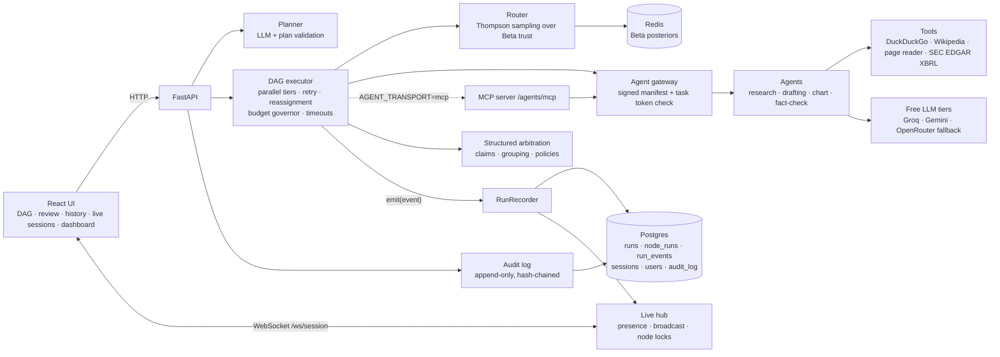

# AGORA architecture (final phase)

This describes the system as built. The mid-term version of this document is in the git history.

## Components

## The event log is the backbone

Every state change in a run goes through one callback, `emit(event_type, payload)`, implemented by
`db/recorder.py`. It writes the event to `run_events`, keeps `node_runs` current and (in a collaborative
session) broadcasts the same event over WebSocket. Because there is only one stream:

- **Replay** rebuilds the state after any event number.
- **Fork** reuses the stored outputs of the nodes that do not depend on the changed node.
- **Live view** shows exactly what is stored; a late joiner's **digest** is computed from it.
- **Observability** metrics are aggregated from it, so the dashboard never shows unbacked numbers.

Event types: `plan_created`, `node_started`, `agent_routed`, `node_attempt_failed`, `node_finished`,
`node_failed`, `node_skipped`, `reputation_updated`, `claims_extracted`, `conflict_found`,
`conflict_resolved`, `node_claimed` / `node_released` / `node_submitted`, `node_takeover_waiting` /
`node_takeover_released`, `budget_economy` / `budget_exhausted` / `budget_downgrade`, `arbitration_error`,
`run_finished` (with the run's token and cost totals).

## A node's life

1. Ready when all its dependencies are done; nodes of one tier run concurrently (`asyncio.gather`).
2. If a person has taken the node over, the executor waits for their text instead (or falls back to an agent).
3. Otherwise the router picks among the skill's agents (budget economy mode may restrict to the cheapest).
4. The executor issues a task-scoped token; the gateway checks the agent's signed manifest and the token.
5. The agent runs its strategy under a timeout; every LLM call lands in the node's usage ledger.
6. The output is graded by the agent's own checks; the grade updates the agent's Beta posterior.
7. Failures retry on the next-best agent; infrastructure errors (rate limits, timeouts) never lower reputation.

After all nodes: structured arbitration; open conflicts make the run `needs_review` until a person decides.

## Trust model

`Beta(p·10 + Σq, (1−p)·10 + Σ(1−q))` per agent, where `p` is the AGORA-Bench prior and `q ∈ [0,1]` the graded
quality of each outcome; evidence decays by 0.97 per update. Updates are a single Redis Lua script (atomic).
Evidence sources: output checks, fact-check verdicts on a drafter's claims, reviewed conflicts (the origin of a
wrong figure gets two zero-quality observations; nodes that merely repeated it are not penalised).

## Security model

| Threat | Control |
|---|---|
| An agent's configuration is swapped (e.g. a cheaper or malicious model) | Ed25519-signed manifests; the registry loads only verified ones; result in the audit log |
| A leaked call credential is reused | Task tokens are valid for 120 s, one run/node, one agent and skill |
| History is rewritten | `audit_log` rejects UPDATE/DELETE (database trigger); the hash chain exposes edits made around the trigger |
| Someone joins a private session | Isolated sessions are owner-only; invite tokens grant editor or viewer; every action checks the role |

The private signing key lives only in `backend/keys/` (gitignored); the public key is committed in
`registry/trusted_keys.json`.

## Key decisions

- **Custom executor, not LangGraph**: full control over events, retries, takeover and budgets.
- **Code decides, LLMs propose**: sources lists, chart specs, citation checks, numeric comparisons and
  final verdict overrides are deterministic; LLMs extract and judge only where language understanding is needed.
- **Server-authoritative collaboration with node locks** instead of a CRDT: simpler, matches the DAG model.
- **Official data beats scraping** for financial figures (SEC EDGAR XBRL).
- **Honest evaluation**: baselines, sample sizes and failures are reported; infrastructure failures are
  excluded and counted, never silently scored.
